<div align="center">


<br>

[](https://github.com/MauricioGarcia98/novamart-lakehouse/actions/workflows/ci.yml)


**Un proyecto real, de punta a punta, para aprender Spark, SQL y modelado de datos en Databricks
— con cientos de millones de filas, datos sucios de verdad y prácticas de producción.**

[En acción](#-el-pipeline-en-acción) ·
[Proceso](#-el-proceso-completo) ·
[Arquitectura](#️-arquitectura) ·
[Modelo de datos](#-modelo-de-datos) ·
[Inicio rápido](#-inicio-rápido) ·
[Ruta de aprendizaje](#-ruta-de-aprendizaje) ·
[Documentación](#-documentación)

</div>

---

## 🎬 El pipeline en acción

<p align="center">
  
</p>

<sub>Ilustración animada del job <code>novamart-e2e-pipeline</code> (<a href="resources/novamart_e2e.job.yml">resources/novamart_e2e.job.yml</a>):
cada tarea pasa de <i>pending</i> → <i>running</i> → <i>succeeded</i>, el <code>for_each</code> de silver procesa las 8 entidades de a 4
y el panel muestra las filas que se escriben en cada capa con <code>scale_factor=1</code>.</sub>

## 🧭 El proceso completo

<p align="center">
  
</p>

> **NovaMart** es un retailer omnicanal ficticio: 6 países de LatAm, ~400 tiendas, web, app y marketplace.
> Sus sistemas generan pedidos, clickstream, CDC de clientes y productos, logística, devoluciones e inventario.
> Este repositorio construye **todo** el camino: desde generar esos datos a escala hasta un modelo dimensional
> listo para dashboards, con calidad, historia, orquestación, gobierno y CI/CD.

## ✨ Qué lo hace distinto

<table>
<tr>
<td width="50%" valign="top">

### 📈 Volumen de verdad
Generador **distribuido en Spark** controlado por `scale_factor`.
Con `SF=1`: **12M pedidos · 36M líneas · 150M eventos web · 157M filas de stock** (~30 GB).
Con `SF=10`, diez veces más. Determinístico y reproducible.

</td>
<td width="50%" valign="top">

### 🧪 Datos sucios a propósito
Duplicados, re-envíos, nulos, cantidades negativas, **3 formatos de fecha**, epoch en ms,
emails y teléfonos sucios, **llegadas tardías** y **schema drift**. Cada problema tiene su solución en el pipeline.

</td>
</tr>
<tr>
<td valign="top">

### 🥇 Modelado profesional
Estrella **Kimball** con 6 dimensiones (2 **SCD Tipo 2**, junk, role-playing) y los
**4 tipos de tablas de hechos**: transaccional, accumulating snapshot, periodic snapshot y agregada.

</td>
<td valign="top">

### ⚙️ Listo para producción
**Asset Bundle** con 3 jobs + 1 pipeline declarativo, `for_each`, quality gate, liquid clustering,
PK/FK, tags PII, **13 tests** (unitarios + e2e con Spark local) y **CI/CD** con GitHub Actions.

</td>
</tr>
<tr>
<td valign="top">

### 🔁 Incremental e idempotente
Auto Loader + checkpoints, `foreachBatch` + `MERGE`, watermarks y `replaceWhere` por fechas afectadas.
Re-ejecutar cualquier paso da el mismo resultado.

</td>
<td valign="top">

### 🎓 Ruta de aprendizaje
**18 módulos** de cero a avanzado — SQL, Spark, Delta, streaming, performance, modelado, gobierno y CI/CD —
con ejercicios y soluciones **sobre las tablas del propio proyecto**.

</td>
</tr>
</table>

## 🏗️ Arquitectura

<p align="center">
  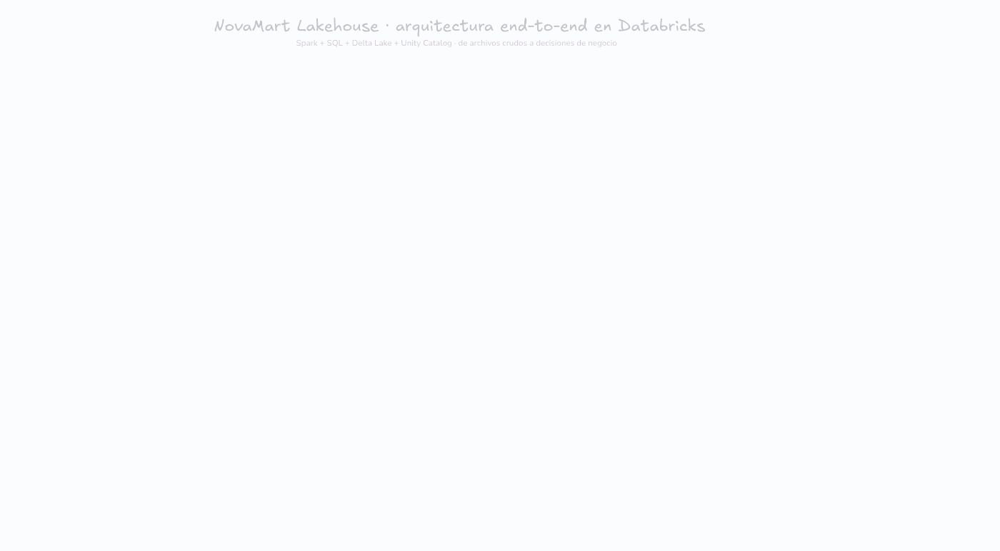
</p>

| Capa | Qué hace | Tecnología |
|---|---|---|
| 🗂️ **Landing** | Archivos crudos tal como llegan, una carpeta por día | UC Volume · CSV · JSON.gz · Parquet |
| 🥉 **Bronze** | Copia fiel e incremental + linaje por archivo, nada se pierde (`_rescued_data`) | Auto Loader · Delta |
| 🥈 **Silver** | Tipado, dedup, reglas de calidad con cuarentena, **SCD2 con MERGE** | Structured Streaming · `foreachBatch` |
| 🥇 **Gold** | Modelo estrella, joins *point-in-time*, marts en SQL | Delta · liquid clustering · Photon |
| 📊 **Consumo** | Dashboards, Genie, SQL, ML | AI/BI · Databricks SQL · MLflow |
| 🛡️ **Transversal** | Orquestación, calidad, gobierno, CI/CD | Lakeflow Jobs · Unity Catalog · DAB · GitHub Actions |

El mismo pipeline está implementado **dos veces**: imperativo (`src/` + notebooks + Job) y declarativo
(**Lakeflow Declarative Pipelines** en SQL con `AUTO CDC` y expectations), para compararlos.

<details>
<summary><b>🔎 Ver el linaje tabla por tabla</b></summary>
<br>
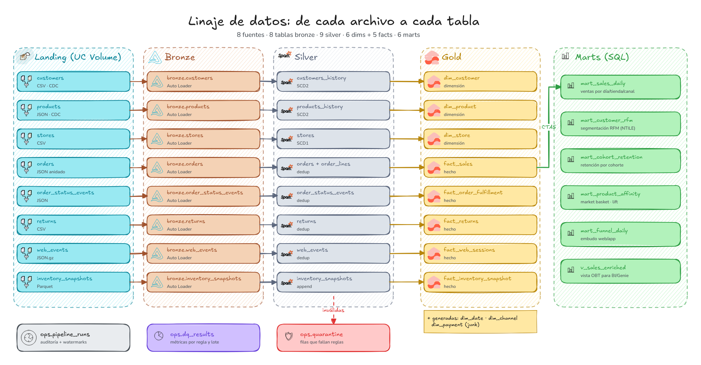
</details>

<details>
<summary><b>🗓️ Ver el DAG del Lakeflow Job</b></summary>
<br>
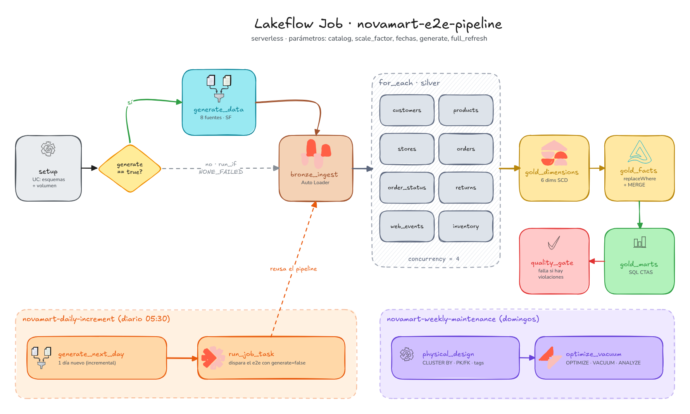
</details>

## 🧩 Modelo de datos

<p align="center">
  
</p>

<table>
<tr>
<td width="50%">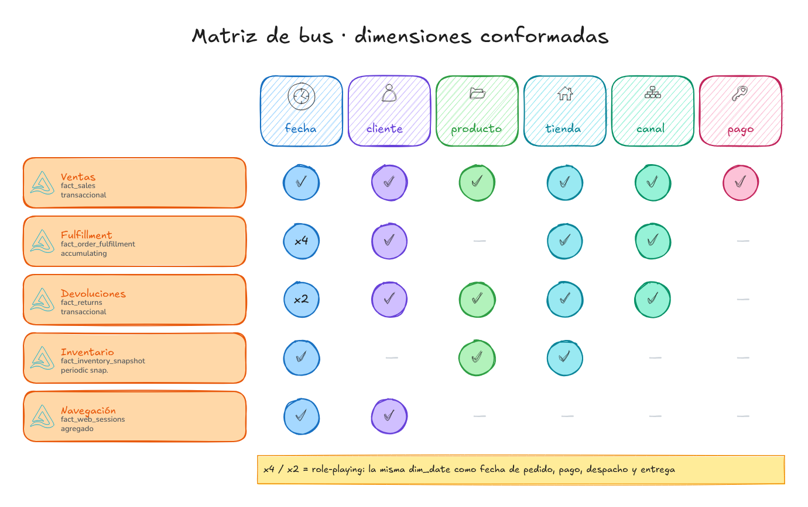</td>
<td width="50%"></td>
</tr>
<tr>
<td align="center"><b>Matriz de bus</b> · dimensiones conformadas</td>
<td align="center"><b>SCD Tipo 2</b> · la historia de un cliente real del dataset</td>
</tr>
</table>

**Marts en SQL** (`sql/gold/marts/`): ventas diarias · segmentación **RFM** con `NTILE` · **retención por cohorte** ·
**market basket** (support, confidence, lift) · **embudo** web/app · vista OBT `v_sales_enriched` para BI y Genie.

## 🚀 Inicio rápido

<details open>
<summary><b>☁️ En Databricks (incluye Free Edition)</b></summary>

```bash
# Databricks CLI: brew install databricks  |  winget install Databricks.DatabricksCLI
databricks auth login --host https://<tu-workspace>.cloud.databricks.com
databricks bundle deploy -t dev
databricks bundle run novamart_e2e -t dev        # pipeline completo (SF=0.1 por defecto)
databricks bundle run novamart_daily -t dev      # simula la llegada de un día nuevo
```

Sin CLI: *Workspace → Create → Git folder* con la URL de este repo y ejecutá `notebooks/00_setup` → `07_data_quality_report`.
En Free Edition, si no podés crear catálogos, usá el widget `catalog = workspace`.

</details>

<details>
<summary><b>💻 En tu máquina (Spark + Delta OSS, sin Databricks)</b></summary>

```bash
python -m venv .venv && source .venv/bin/activate
pip install -e ".[dev]"                                     # requiere Java 17+
python scripts/run_local.py --scale-factor 0.002 --start 2025-01-01 --end 2025-03-31
python scripts/run_local.py --increment 2025-04-01          # carga incremental
pytest -m "not integration"                                 # unitarios (~1 min)
pytest -m integration                                       # pipeline e2e + incremental (~10 min)
```

</details>

### 📊 Volúmenes por `scale_factor`

| SF | pedidos | líneas | eventos web | stock | tamaño | ideal para |
|---:|---:|---:|---:|---:|---:|---|
| 0.002 | 24 K | 56 K | 280 K | 5 K | ~50 MB | tests / CI |
| 0.1 | 1,2 M | 3,6 M | 15 M | 1,6 M | ~3 GB | Free Edition |
| **1** | **12 M** | **36 M** | **150 M** | **157 M** | **~30 GB** | workspace serverless |
| 10 | 120 M | 360 M | 1.500 M | 1.570 M | ~300 GB | clusters multi-nodo |

<sub>La fila SF=0.002 son conteos reales de una corrida local de 3 meses; el resto son estimaciones para el rango por defecto de 3 años.</sub>

## 🎓 Ruta de aprendizaje

<p align="center">
  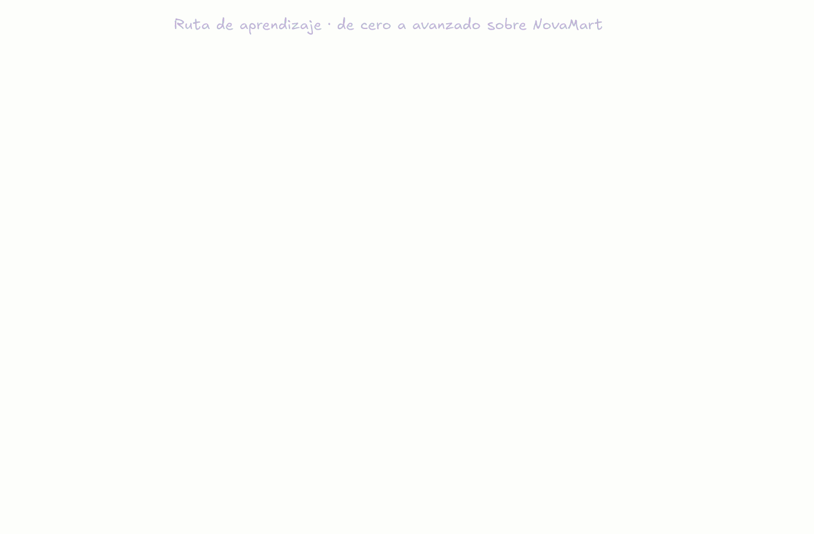
</p>

| Nivel | Módulos | Temas |
|---|---|---|
| 🟦 **0-1 · SQL** | 00 – 04 | Unity Catalog, SELECT, agregaciones, JOINs sobre la estrella, CTEs |
| 🟩 **1 · SQL analítico** | 05 – 07 | ventanas, QUALIFY, sessionización, tipos/ANSI, PIVOT, ROLLUP, MERGE, time travel |
| 🟧 **2 · Spark** | 08 – 12 | arquitectura, DataFrames, UDFs vs nativo, **skew + salting**, AQE, Delta a fondo, streaming |
| 🟪 **3 · Modelado** | 13 | grano, tipos de facts, SCD 0-3, role-playing, OBT vs estrella vs Data Vault |
| 🟢 **4 · Producción** | 14 – 17 | declarativo vs imperativo, gobierno, Jobs + CI/CD, 8 desafíos senior |

👉 Empezá por [`learning/README.md`](learning/README.md).

## 🗂️ Estructura

```text
novamart-lakehouse/
├── databricks.yml              # Asset Bundle: targets dev / prod
├── resources/                  # jobs (e2e, diario, mantenimiento) + pipeline declarativo
├── src/novamart/               # paquete Python testeable
│   ├── datagen/                #   generador distribuido (8 fuentes, estacionalidad, ruido)
│   ├── ingestion/              #   bronze con Auto Loader
│   ├── silver/                 #   transforms puras, reglas, SCD2, cargas incrementales
│   ├── gold/                   #   dimensiones, facts, marts
│   ├── quality/                #   expectations + cuarentena
│   └── utils/                  #   Spark, Delta (MERGE, replaceWhere), auditoría
├── notebooks/                  # orquestadores delgados usados por el Job
├── pipelines/                  # Lakeflow Declarative Pipelines (SQL)
├── sql/                        # marts + diseño físico + gobierno
├── learning/                   # 18 módulos de aprendizaje
├── tests/                      # pytest unitarios + e2e
└── docs/                       # documentación, diagramas Excalidraw y animaciones
```

## 📚 Documentación

| Documento | Contenido |
|---|---|
| [Arquitectura](docs/01_arquitectura.md) | capas, decisiones de diseño (ADR), flujo incremental |
| [Fuentes y datos](docs/02_fuentes_y_datos.md) | volúmenes, problemas inyectados, diccionario de datos |
| [Modelado](docs/03_modelado_de_datos.md) | Kimball, SCD, claves subrogadas, estrella vs OBT vs Data Vault |
| [Performance](docs/04_performance_y_volumen.md) | técnicas aplicadas, skew, tiempos de referencia |
| [Despliegue](docs/05_despliegue.md) | bundle, Free Edition, CI/CD, runbooks |
| [Diagramas](docs/diagrams/README.md) | 10 diagramas Excalidraw editables + animaciones Excalimate |

<details>
<summary><b>🖼️ Galería de diagramas</b></summary>
<br>

| | |
|---|---|
| 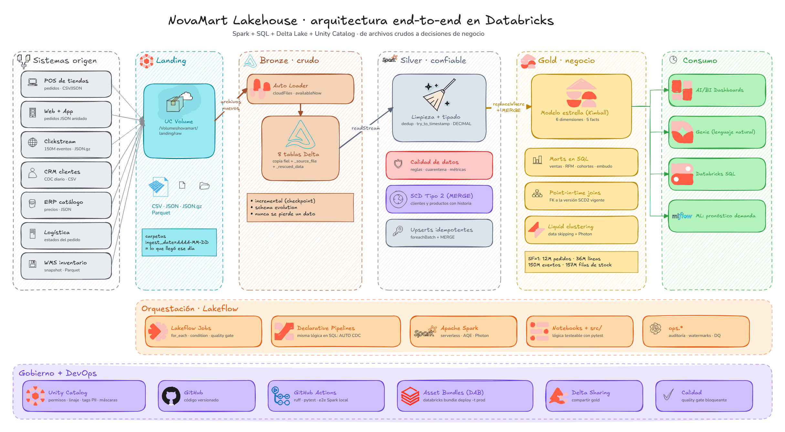 | 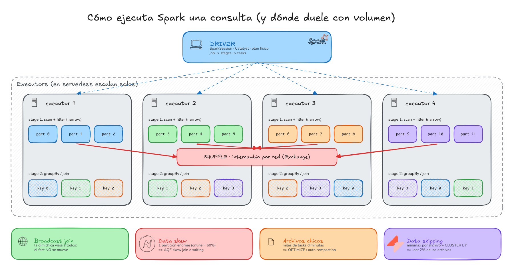 |
| Arquitectura end-to-end | Cómo ejecuta Spark (shuffle, skew, broadcast) |
| 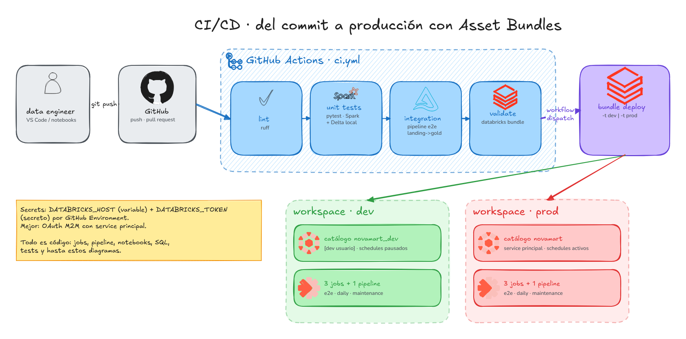 | 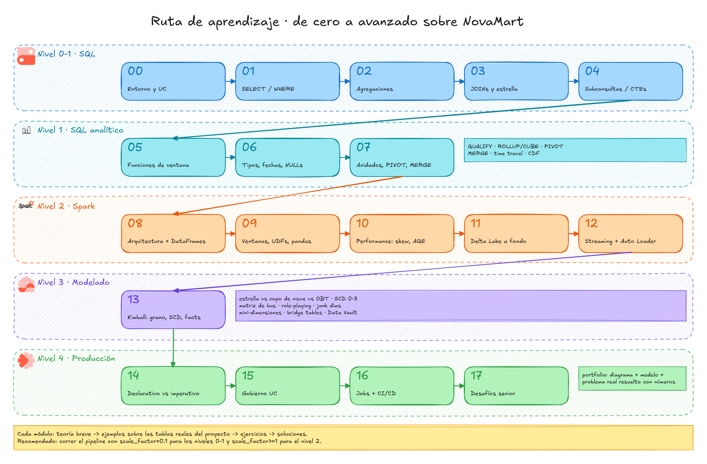 |
| CI/CD con Asset Bundles | Ruta de aprendizaje |

Todos son archivos `.excalidraw` editables en [excalidraw.com](https://excalidraw.com), construidos con iconos de
[libraries.excalidraw.com](https://libraries.excalidraw.com). Las animaciones `.excanim` se abren en
[Excalimate](https://excalimate.com) para exportar a MP4/GIF.

</details>

## 🛠️ Stack

<p align="center">


</p>

## 👤 Autor

**Mauricio García** — Data / SQL / Python
[GitHub](https://github.com/MauricioGarcia98) · [LinkedIn](https://www.linkedin.com/in/nahuel-garc%C3%ADa-data)

<sub>Datos 100% sintéticos: cualquier parecido con personas o empresas reales es coincidencia.
Las marcas mencionadas pertenecen a sus dueños. Licencia [MIT](LICENSE).</sub>
