# 06 · Guía paso a paso: replicar NovaMart desde la página web de Databricks

> **Para quién es:** para alguien que nunca usó Databricks. No hace falta instalar nada en tu PC:
> todo se hace desde el navegador. Cada paso tiene sub-pasos y un "¿qué estoy haciendo?" para que
> entiendas el porqué, no sólo el cómo.
>
> **Ojo:** Databricks cambia los nombres de los menús seguido (en 2026, por ejemplo, *Genie spaces*
> pasó a llamarse *Genie Agents*). Si un botón no se llama exactamente igual, buscá el más parecido
> o usá el buscador de arriba del workspace.

---

## Mapa general (lo que vas a hacer)

| # | Paso | Tiempo aprox. |
|---|---|---|
| 0 | Entender las piezas (5 conceptos) | 10 min |
| 1 | Crear la cuenta gratuita (Free Edition) | 5 min |
| 2 | Recorrer la interfaz | 10 min |
| 3 | Crear el catálogo `novamart_dev` | 3 min |
| 4 | Traer el código desde GitHub (Git folder) | 5 min |
| 5A | Desplegar el bundle desde la web (camino recomendado) | 10 min |
| 5B | …o correr los notebooks a mano (camino didáctico) | 60–90 min |
| 6 | Ejecutar el job y leer los resultados | 40–60 min (espera) |
| 7 | Explorar los datos (Catálogo + SQL Editor) | 20 min |
| 8 | Armar un dashboard | 20 min |
| 9 | Crear un Genie Agent para preguntar en lenguaje natural | 20 min |
| 10 | Correr el pipeline declarativo (opcional) | 15 min |
| 11 | Limpiar y cuidar la cuota gratuita | 5 min |

---

## Paso 0 · Las 5 piezas que tenés que entender antes de tocar nada

1. **Workspace:** tu "escritorio" en Databricks. Ahí viven carpetas, notebooks, jobs, dashboards.
2. **Unity Catalog (UC):** el "archivero" de los datos. Se organiza en 3 niveles:
   `catálogo.esquema.tabla` → por ejemplo `novamart_dev.gold.fact_sales`.
   * *Catálogo* = el proyecto/ambiente (`novamart_dev`).
   * *Esquema* = la capa (`landing`, `bronze`, `silver`, `gold`, `ops`).
   * *Tabla* = los datos.
   * *Volumen* = una carpeta para **archivos** (CSV, JSON, Parquet) dentro de UC.
3. **Compute (cómputo):** las máquinas que ejecutan el código. En Free Edition se usa **serverless**:
   no creás clusters, Databricks te presta máquinas al instante.
4. **Notebook:** un documento con celdas de código (Python/SQL) que se ejecutan una por una.
5. **Job (Lakeflow Job):** una "receta" que ejecuta varios notebooks en orden, con dependencias,
   reintentos y parámetros. Es lo que en una empresa corre todas las noches sin que nadie toque nada.

Y una sexta, que es la estrella de este repo:

6. **Bundle (archivo `databricks.yml`)** — se llamaba *Asset Bundle* y en 2026 pasó a llamarse
   *Declarative Automation Bundle* (la UI dice "Connected to Declarative Automation Bundles"): describe *en código* los jobs, pipelines y esquemas.
   En vez de crear el job a mano con clics, el bundle lo crea igual siempre. Eso se llama
   **infraestructura como código**.

---

## Paso 1 · Crear tu cuenta gratuita (Free Edition)

1. Entrá a **https://www.databricks.com/learn/free-edition**.
2. Hacé clic en **Sign up** / **Get started for free**.
   1. Elegí registrarte con **Google**, **Microsoft** o con tu email.
   2. Si usás email: te llega un código de verificación → pegalo.
3. Cuando te pregunte el uso, elegí lo que corresponda (personal / aprendizaje).
4. Esperá 1–2 minutos: Databricks crea tu **workspace**. Vas a ver una URL tipo
   `https://dbc-xxxxxxxx-xxxx.cloud.databricks.com`. **Guardala**: es la dirección de tu workspace.

> **¿Qué estoy haciendo?** Estás creando tu propio entorno de Databricks gratis, con límites de uso
> (máquinas chicas, un SQL warehouse 2X-Small, cuotas diarias). Si superás la cuota, el cómputo se
> apaga hasta el día siguiente: **no te cobra**.

---

## Paso 2 · Recorrer la interfaz (barra lateral izquierda)

Abrí cada menú una vez para ubicarte:

| Menú | Para qué sirve | Lo vas a usar en |
|---|---|---|
| **Workspace** | Carpetas y archivos (notebooks, código del repo) | Paso 4 |
| **Catalog** | Explorar catálogos, esquemas, tablas, volúmenes | Pasos 3 y 7 |
| **Jobs & Pipelines** | Ver/crear jobs y pipelines, ver ejecuciones | Pasos 6 y 10 |
| **Compute** | Clusters y SQL warehouses | Paso 7 |
| **SQL Editor** | Escribir consultas SQL | Paso 7 |
| **Dashboards** | Tableros visuales (AI/BI) | Paso 8 |
| **Genie Agents** | Preguntar a los datos en lenguaje natural | Paso 9 |

Arriba a la derecha está tu **usuario** (ícono redondo) → *Settings*: ahí se configuran GitHub,
tokens y preferencias.

---

## Paso 3 · Crear el catálogo `novamart_dev`

> **¿Por qué primero?** El pipeline declarativo necesita que el catálogo exista *antes* del deploy.
> En Free Edition (Default Storage) **la API no puede crear catálogos**, pero la UI y SQL sí.
> (Esto lo descubrimos en la primera ejecución real: ver [07_bitacora](07_bitacora_primera_ejecucion.md).)

**Opción A — con clics:**

1. Barra lateral → **Catalog**.
2. Arriba del árbol de catálogos, clic en **+** (o el botón **Create**) → **Create a catalog**.
3. Completá:
   1. **Catalog name:** `novamart_dev`
   2. **Type:** *Standard*
   3. **Storage location:** dejá *Default storage* (o vacío).
4. Clic en **Create**.
5. Comprobá que aparece `novamart_dev` en el árbol de la izquierda.

   
   > 👀 Así se ve después de correr el job: los esquemas `bronze`, `silver`, `gold`, `landing`, `ops` y `dev_<tu_usuario>_ldp` (el del pipeline declarativo; el prefijo lo agrega el modo `development`).

**Opción B — con SQL:**

1. Barra lateral → **SQL Editor** → **+ New query**.
2. Arriba, elegí el warehouse **Serverless Starter Warehouse**.
3. Escribí y ejecutá (botón **Run** o `Ctrl/Cmd + Enter`):
   ```sql
   CREATE CATALOG IF NOT EXISTS novamart_dev COMMENT 'NovaMart Lakehouse';
   ```

> Los **esquemas** (`landing`, `bronze`, …) y el **volumen** los crea solo el notebook `00_setup`.

---

## Paso 4 · Traer el código desde GitHub (Git folder)

1. Barra lateral → **Workspace** → entrá a tu carpeta personal (**Home**, con tu email).
2. Arriba a la derecha: **Create** → **Git folder**.
3. Completá:
   1. **Git repository URL:** `https://github.com/MauricioGarcia98/novamart-lakehouse`
      (o la URL de *tu* repo, ver Paso 12).
   2. **Git provider:** *GitHub* (se completa solo).
   3. **Git folder name:** `novamart-lakehouse`.
4. Clic en **Create Git folder**. En segundos ves todas las carpetas: `notebooks/`, `src/`,
   `resources/`, `learning/`, `docs/`…
5. **Si el repo es privado:** antes tenés que vincular GitHub:
   1. Usuario (arriba a la derecha) → **Settings** → **Linked accounts**.
   2. **Git integration** → *GitHub* → **Link Git account** → autorizá la app de Databricks.
   3. Volvé al sub-paso 2.

> **¿Qué estoy haciendo?** Un *Git folder* es una copia del repo dentro del workspace, conectada a
> GitHub. Desde el ícono de rama (arriba, al lado del nombre) podés hacer **pull** (traer cambios),
> **commit & push** (subir cambios) y cambiar de rama, sin salir del navegador.

---

## Paso 5A · Desplegar el bundle desde la web (recomendado)

El repo trae un `databricks.yml`. Databricks lo reconoce y te deja desplegarlo con un botón.

1. En el Git folder, hacé clic en el archivo **`databricks.yml`**.
2. A la derecha aparece el panel de **Deployments** (ícono de cohete 🚀). Si no lo ves, buscá el
   botón **Open in deployments** o el ícono del cohete en la barra derecha.
3. En **Target**, elegí **dev**.
4. Clic en **Deploy**.
   1. Te muestra qué va a crear: 3 jobs, 1 pipeline y 1 esquema. Confirmá. El esquema se va a
      llamar `dev_<tu_usuario>_ldp`: en modo `development` el bundle le agrega tu usuario adelante
      para que tu ambiente de pruebas no pise el de otra persona.
   2. Esperá a que termine (1–2 min). Si falla, el panel muestra el error en rojo.
5. Cuando termina, el panel lista los recursos creados con el prefijo **`[dev tu_usuario]`**:
   * `[dev …] novamart-e2e-pipeline` (el pipeline completo)
   * `[dev …] novamart-daily-increment` (simula un día nuevo)
   * `[dev …] novamart-weekly-maintenance` (mantenimiento)
   * `[dev …] novamart-declarative-pipeline` (versión SQL declarativa)

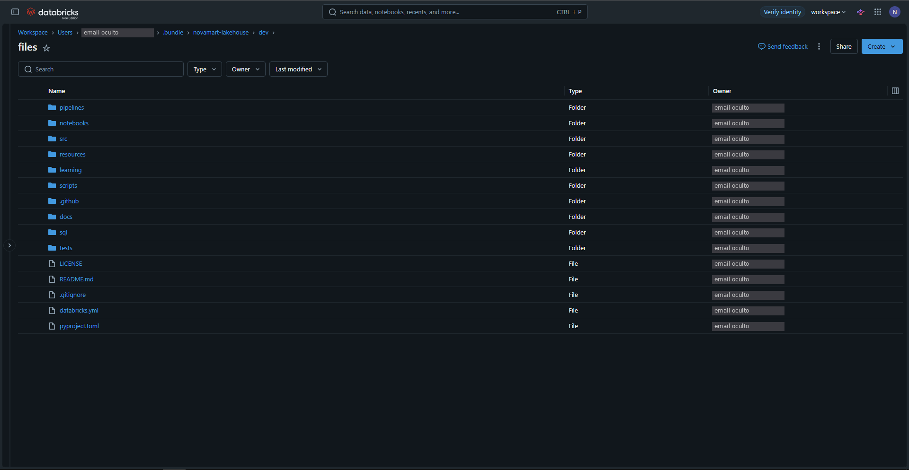
> 👀 El deploy copia el código a `Workspace › Users › <tu email> › .bundle › novamart-lakehouse › dev › files`.

> **¿Qué estoy haciendo?** Lo mismo que `databricks bundle deploy -t dev` por terminal: subir el
> código y crear los jobs tal cual están definidos en `resources/*.yml`. El modo `development`
> prefija los nombres con tu usuario y **pausa los schedules** para que nada corra solo.

Seguí al **Paso 6**.

---

## Paso 5B · Correr los notebooks a mano (para aprender qué hace cada etapa)

Sirve para ver paso a paso qué pasa en cada capa. Tarda más.

1. Abrí `notebooks/00_setup`.
2. Arriba a la derecha: **Connect** → elegí **Serverless**.
3. Arriba del notebook aparecen los **widgets** (cajitas de parámetros). Completá:
   1. `catalog` = `novamart_dev`
   2. `scale_factor` = `0.1` (≈ 3 GB; no subas más en Free Edition)
   3. `start_date` / `end_date`: dejalos como están.
4. Clic en **Run all**. Esperá a que todas las celdas tengan ✓ verde.
5. Repetí con cada notebook **en este orden**, con los mismos widgets:

   | Orden | Notebook | Qué hace | Widgets extra |
   |---|---|---|---|
   | 1 | `01_generate_data` | Genera los archivos "crudos" en el volumen (≈ 25 min) | `mode = full` |
   | 2 | `02_bronze_ingest` | Auto Loader: archivos → tablas bronze | — |
   | 3 | `03_silver_entity` | Limpia una entidad → silver | `entity` (ver abajo) |
   | 4 | `04_gold_dimensions` | Dimensiones (clientes, productos, tiendas, fechas) | — |
   | 5 | `05_gold_facts` | Hechos (ventas, devoluciones, sesiones…) | `full_refresh = false` |
   | 6 | `06_gold_marts` | Marts para negocio (RFM, cohortes, funnel…) | — |
   | 7 | `07_data_quality_report` | Quality gate: ¿los datos tienen sentido? | — |

6. **`03_silver_entity` se corre 8 veces**, una por entidad. Cambiá el widget `entity` y
   ejecutá **Run all** cada vez:
   `customers`, `products`, `stores`, `orders`, `order_status_events`, `returns`, `web_events`,
   `inventory_snapshots`.
7. Si una celda falla: leé el mensaje rojo de abajo de la celda (la **última línea** suele decir
   el error real) y consultá la [bitácora](07_bitacora_primera_ejecucion.md).

> Tip: en cualquier celda podés abrir **Genie Code** (ícono de chispa ✨ o `Ctrl/Cmd + I`) y
> preguntarle *"explicame qué hace esta celda"* o *"¿por qué falló?"*. Ver [09_genie_a_fondo](09_genie_a_fondo.md).

---

## Paso 6 · Ejecutar el job y leer los resultados

1. Barra lateral → **Jobs & Pipelines**.
2. Buscá **`[dev tu_usuario] novamart-e2e-pipeline`** y entrá.

   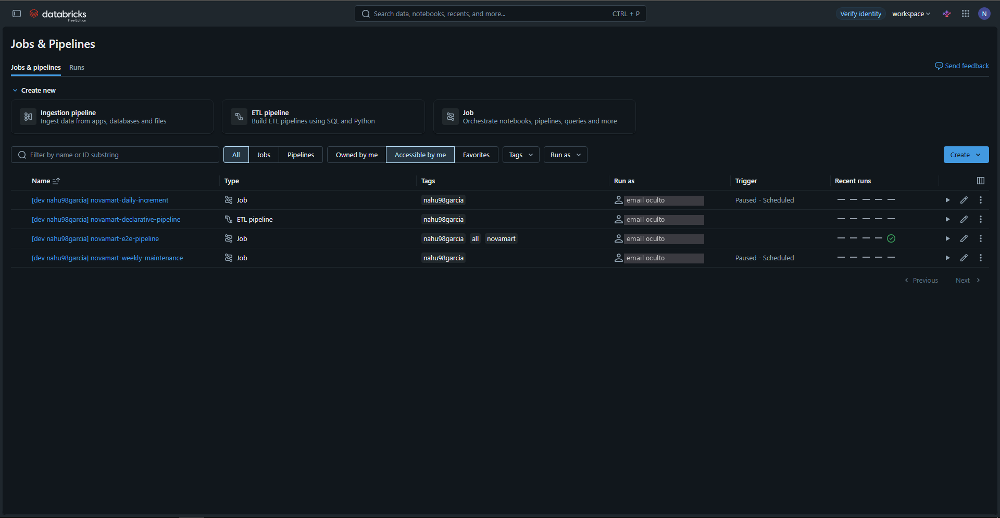
   > 👀 Los 4 recursos del bundle con prefijo `[dev …]`. Los que tienen schedule dicen *Paused - Scheduled*: el modo `development` los pausa.
3. Pestaña **Tasks**: vas a ver el **DAG** (el dibujo de tareas conectadas):
   `setup → should_generate → generate_data → bronze_ingest → silver (x8) → gold_dimensions → gold_facts → gold_marts → data_quality_gate`.
   1. `should_generate` es un **if/else**: si el parámetro `generate` es `true`, genera datos; si no, salta directo a bronze.
   2. `silver` es un **for each**: corre el mismo notebook 8 veces (una por entidad), de a 4 en paralelo.

   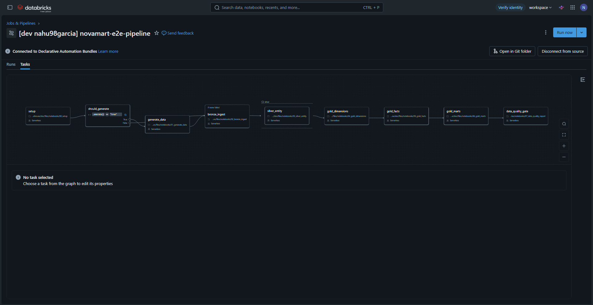
   > 👀 Mirá las salidas **True/False** de `should_generate`, la etiqueta **If none failed** sobre `bronze_ingest` y el recuadro punteado **silver** (el for each).
4. Arriba a la derecha: flecha al lado de **Run now** → **Run now with different parameters**.
   1. `catalog` = `novamart_dev`
   2. `scale_factor` = `0.1`
   3. `generate` = `true` (la primera vez **sí** hay que generar datos)
   4. Clic en **Run**.
   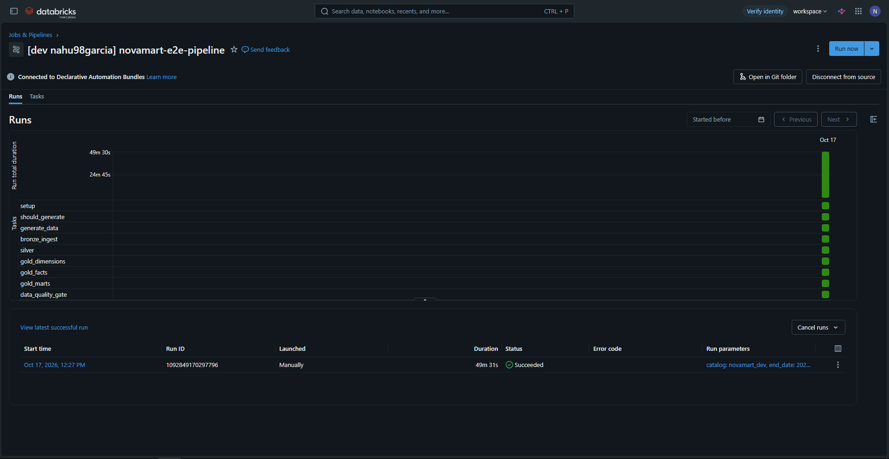
   > 👀 Una ejecución de 49 min 31 s, *Succeeded*, con la grilla de tareas en verde.
5. Pestaña **Runs** → clic en la ejecución → ves cada tarea cambiar de color:
   gris (esperando) → azul (corriendo) → verde (OK) / rojo (falló).
6. **Si una tarea falla:**
   1. Clic en la tarea roja → abajo aparece el **output** con el error.
   2. Arreglá el problema (en el Git folder: editá, **commit & push**, y volvé a desplegar el bundle).
   3. Volvé al run → botón **Repair run** → marcá las tareas fallidas → **Repair**.
      > *Repair run* re-ejecuta **sólo** lo que falló y lo que depende de eso. No vuelve a generar
      > los datos (te ahorra ~25 min).

   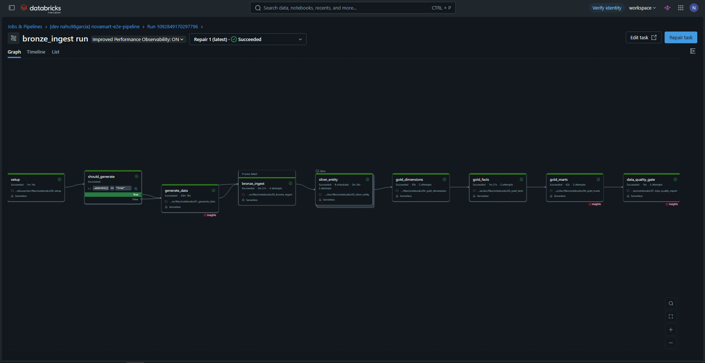
   > 👀 Arriba dice **Repair 1 (latest) · Succeeded**; en `bronze_ingest` se lee **4 attempts** (3 fallidos + el del repair).

   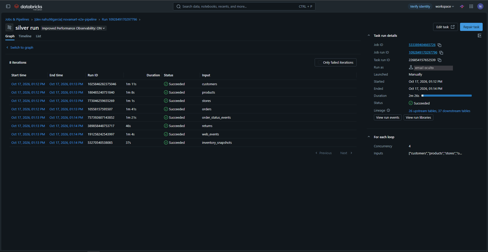
   > 👀 Cada entidad con su duración; a la derecha **Concurrency 4**: arrancan de a 4 al mismo tiempo.

7. Así se vio la primera ejecución real (con sus fallos y el *repair*):

   

8. Tiempos reales de la primera ejecución con `scale_factor=0.1` en Free Edition:
   setup 1 min · generate_data 25 min · bronze 3 min · silver 2,5 min · gold ~2,5 min · calidad 12 s.

---

## Paso 7 · Explorar los datos

**En el Catálogo:**

1. Barra lateral → **Catalog** → `novamart_dev` → `gold` → `fact_sales`.
2. Pestañas útiles:
   1. **Overview:** columnas y tipos.
   2. **Sample data:** primeras filas (necesita un warehouse encendido).
   3. **Lineage:** de qué tablas viene esta tabla (¡mirá cómo llega desde bronze!).
   4. **History:** versiones de la tabla Delta (*time travel*).

   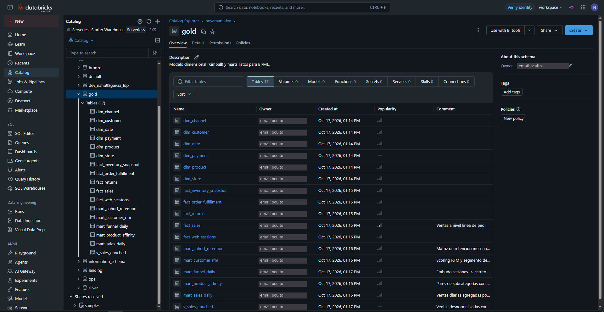
   > 👀 Dimensiones (`dim_`), hechos (`fact_`), marts (`mart_`) y una vista (`v_sales_enriched`). Bronze y silver se ven igual: [bronze](img/ui/03b_esquema_bronze.png) · [silver](img/ui/03c_esquema_silver.png).

   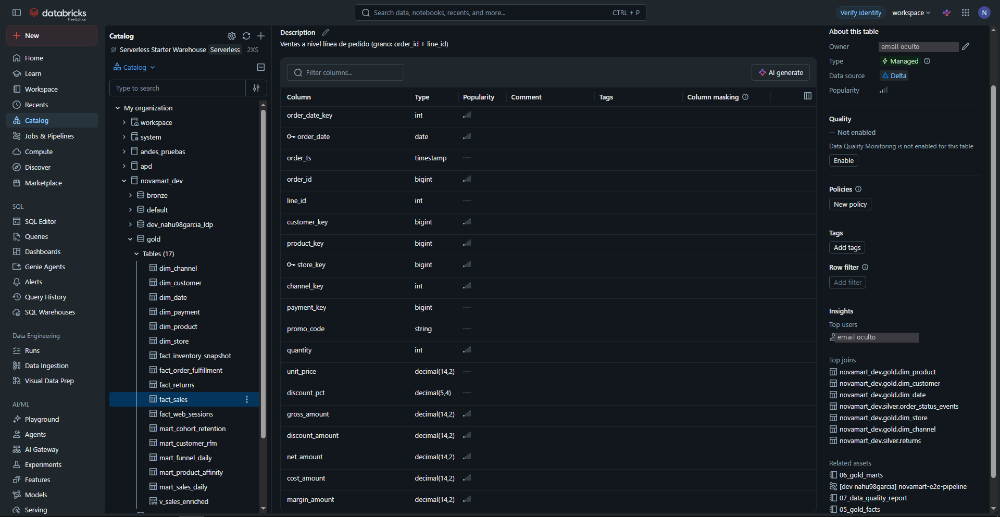
   > 👀 Las columnas con ícono de **llave** (`order_date`, `store_key`) son las de *liquid clustering*. En **Top joins** se ve el modelo estrella en acción.

   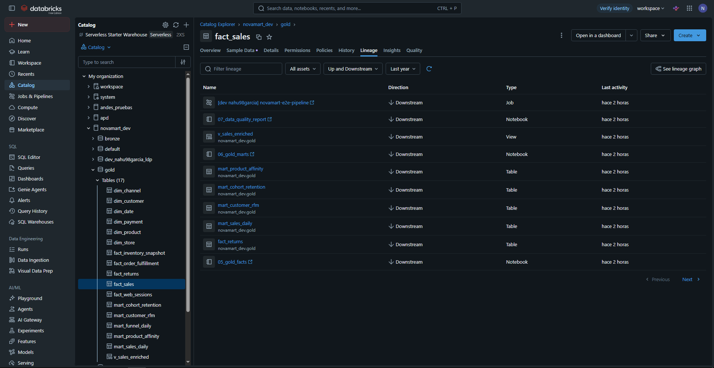
   > 👀 Todo lo que depende de `fact_sales` (*Downstream*). Cambiá a *Upstream* o abrí **See lineage graph** para ver de dónde viene.

   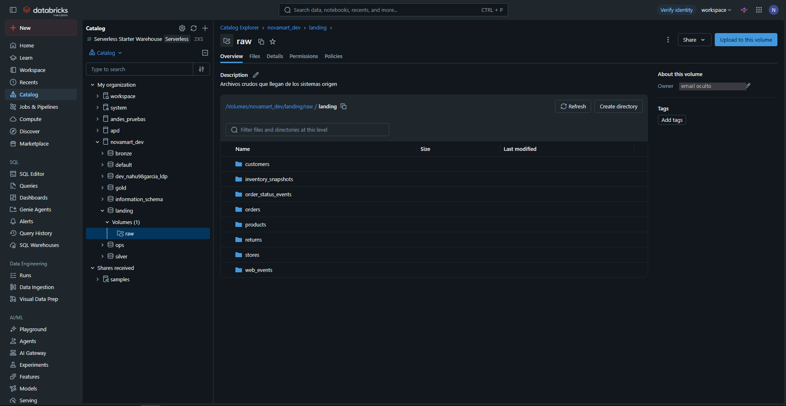
   > 👀 Las 8 carpetas de archivos crudos que lee Auto Loader en bronze.

**En el SQL Editor:**

1. **SQL Editor** → **+ New query** → warehouse *Serverless Starter Warehouse*.
2. Arriba, elegí catálogo `novamart_dev` y esquema `gold` para no escribir nombres largos.
3. Probá estas consultas una por una:
   ```sql
   -- ¿Cuánto se vendió por año?
   SELECT d.year, ROUND(SUM(f.net_amount)/1e6, 1) AS ventas_millones
   FROM fact_sales f JOIN dim_date d ON f.order_date_key = d.date_key
   GROUP BY d.year ORDER BY d.year;

   -- ¿Qué reglas de calidad encontraron problemas?
   SELECT table_name, rule, action, failed_rows, total_rows
   FROM novamart_dev.ops.dq_results WHERE failed_rows > 0;

   -- ¿Qué registros se mandaron a cuarentena y por qué?
   SELECT table_name, failed_rules, record FROM novamart_dev.ops.quarantine LIMIT 20;
   ```
   > Si una columna no existe con ese nombre, abrí la tabla en el Catálogo (Overview) y ajustá.

   
   > 👀 Resultado real: 496,3 · 589,2 · 690,4 millones.
4. Seguí con la **ruta de aprendizaje**: carpeta `learning/`, desde `00_bienvenida_y_entorno`.

---

## Paso 8 · Armar un dashboard (AI/BI)

1. Barra lateral → **Dashboards** → **Create dashboard**.
2. Pestaña **Data** → **Add data source** → elegí `novamart_dev.gold.mart_sales_daily`
   (o escribí una consulta SQL).
3. Pestaña del lienzo (**Canvas**) → **Add a visualization**:
   1. Elegí el dataset.
   2. Tipo **Line**: eje X = `order_date` (agrupado por mes), eje Y = `SUM(net_sales)`.
   3. O escribile al asistente del widget: *"ventas netas por mes y por canal"*.
4. Agregá un **filtro** (Add filter) por país o canal.
5. **Publish** → podés compartirlo y programar envíos por mail.

---

## Paso 9 · Crear un Genie Agent (preguntar en lenguaje natural)

1. Barra lateral → **Genie Agents** (sección SQL) → **New** (antes se llamaba *Genie space*).
   Se abre **Connect your data** para elegir las tablas:

   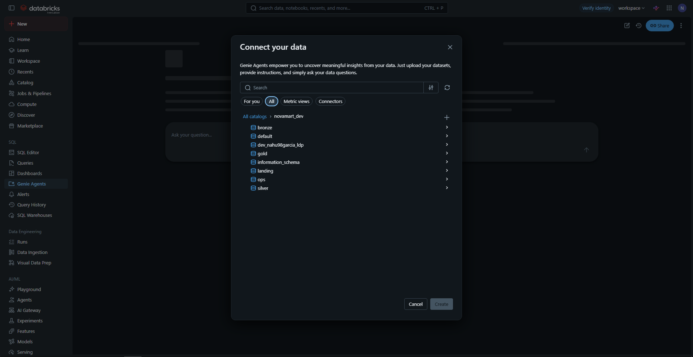
   > 👀 También podés elegir **Metric views** (pestaña de arriba): son las métricas oficiales del negocio.

2. **Data sources:** agregá pocas tablas bien elegidas (5–10):
   `gold.fact_sales`, `gold.dim_date`, `gold.dim_product`, `gold.dim_store`, `gold.dim_customer`, `gold.mart_sales_daily`.
3. **Instructions:** escribí reglas de negocio cortas, por ejemplo:
   * "Ventas = SUM(net_amount) de fact_sales. Nunca uses gross_amount salvo que lo pidan."
   * "El año fiscal coincide con el calendario. Moneda: USD."
   * "Para clientes usá sólo la versión vigente (is_current = true) de dim_customer."
4. **SQL examples:** agregá 3–5 preguntas con su SQL correcto (las del Paso 7 sirven).
5. Preguntá: *"¿Cuáles fueron los 10 productos más vendidos en Chile en 2025?"*
   1. Abrí **Show code** para ver el SQL que generó.
   2. Si está mal, corregilo y guardalo como ejemplo (así aprende).
6. **Benchmarks:** cargá 10 preguntas con su respuesta correcta y corré la evaluación cada vez que
   cambies las instrucciones.

> Todo el detalle de Genie está en [09_genie_a_fondo](09_genie_a_fondo.md).

---

## Paso 10 · Pipeline declarativo (opcional)

1. **Jobs & Pipelines** → `[dev …] novamart-declarative-pipeline`.
2. Clic en **Start**. Se abre el grafo: tablas bronze → silver → gold escritas **sólo en SQL**
   (`pipelines/*.sql`).
3. Compará con la versión de notebooks: mismo resultado, otro estilo (declarativo vs imperativo).
   Es el módulo 14 de la ruta de aprendizaje.
4. En Free Edition hay **un pipeline activo por tipo** a la vez: esperá que termine antes de otro.

   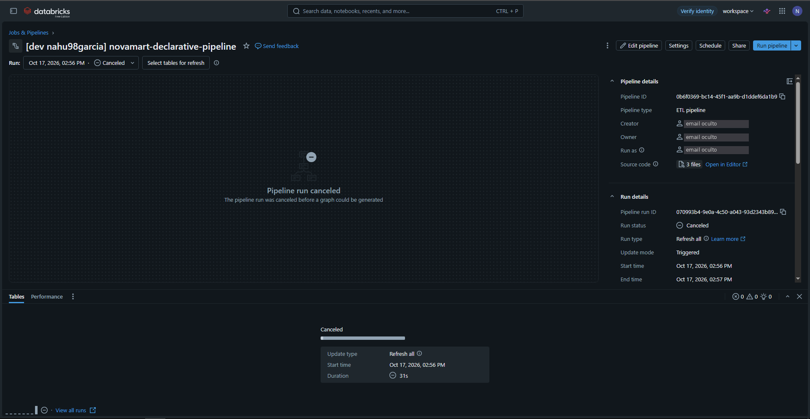
   > 👀 Si cancelás la ejecución antes de que arranque, el grafo no se dibuja (*Pipeline run canceled*). Dejala terminar (5–15 min) para ver las tablas.


---

## Paso 11 · Limpiar y cuidar la cuota

* No dejes el warehouse encendido: **Compute → SQL warehouses** → *Stop* (igual se apaga solo).
* Para empezar de cero: en SQL Editor →
  `DROP CATALOG novamart_dev CASCADE;` (borra **todo**: tablas, archivos, checkpoints).
* Para borrar jobs/pipelines del bundle: panel **Deployments** → **Destroy**
  (o `databricks bundle destroy -t dev` desde terminal).

---

## Paso 12 · Hacer el repositorio 100% tuyo

### ¿Qué es la rama `claude/youthful-albattani-lve01t`?

Es una **rama de trabajo**, como un borrador al costado de tu rama principal (`main`). El nombre lo
generó la sesión de Claude Code. **El repositorio ya es tuyo** (`MauricioGarcia98/novamart-lakehouse`):
la rama es sólo una etiqueta y se puede borrar sin perder nada, siempre que primero pases sus
cambios a `main`.

### Opción 1 · Pasar los cambios a `main` y borrar la rama (recomendada, se hace en la web)

1. Entrá al repo en GitHub → aparece un aviso amarillo **"claude/… had recent pushes"** →
   **Compare & pull request**. (Si no aparece: pestaña **Pull requests** → **New pull request** →
   *base:* `main`, *compare:* `claude/youthful-albattani-lve01t`.)
2. Revisá los cambios en **Files changed** (¡es buena práctica leer lo que entra!).
3. **Create pull request**.
4. En el botón verde, elegí la flecha → **Squash and merge**.
   1. Esto junta todos los commits de la rama en **un solo commit** en `main`.
   2. En el mensaje podés borrar las líneas `Co-Authored-By: …` si querés.
   3. **Confirm squash and merge**.
5. Clic en **Delete branch** (aparece justo después del merge).
6. Listo: `main` tiene todo y la rama `claude/…` desapareció.

### Opción 2 · Descargar todo y subirlo de cero, con historial 100% tuyo

Esto crea un repo nuevo con **un solo commit tuyo** y sin rastros de ramas anteriores.

1. **Descargar:** en GitHub → botón verde **Code** → **Download ZIP** (elegí la rama `main`
   después de hacer la Opción 1, o la rama `claude/…` si no la mergeaste).
2. Descomprimí el ZIP en tu PC (ej. `C:\proyectos\novamart-lakehouse`).
   > El ZIP **no** trae la carpeta oculta `.git`: o sea, no trae historial. Justo lo que queremos.
3. Instalá Git: https://git-scm.com/downloads (siguiente, siguiente, finalizar).
4. Configurá tu identidad (una sola vez), en una terminal (*Git Bash* en Windows):
   ```bash
   git config --global user.name "Tu Nombre"
   git config --global user.email "tu-email@ejemplo.com"
   ```
5. Creá un repo **vacío** en GitHub: **+** (arriba a la derecha) → **New repository** →
   nombre (ej. `novamart-lakehouse-v2`) → **sin** README, sin .gitignore, sin licencia → **Create**.
6. En la terminal, dentro de la carpeta descomprimida:
   ```bash
   git init -b main
   git add .
   git commit -m "NovaMart Lakehouse: proyecto end-to-end en Databricks"
   git remote add origin https://github.com/TU_USUARIO/novamart-lakehouse-v2.git
   git push -u origin main
   ```
   La primera vez GitHub te pide login (se abre el navegador).
7. Opcional: borrá el repo viejo (**Settings** del repo → abajo de todo → **Delete this repository**).
8. Si cambiaste el nombre del repo, actualizá las URLs del `README.md` (badges y enlaces).

> **Sobre la autoría:** con la Opción 2 todo el historial queda a tu nombre. Está bien que el
> proyecto sea tuyo, y la licencia MIT ya está a tu nombre. Igual, en entrevistas lo que suma es
> poder **explicar cada decisión**. Por eso conviene hacer la ruta `learning/` y la bitácora antes de
> mostrarlo.

---

## Si algo falla: errores típicos

| Error (última línea del mensaje) | Qué significa | Qué hacer |
|---|---|---|
| `CATALOG_DOES_NOT_EXIST` | El catálogo no existe | Paso 3 |
| `Metastore storage root URL does not exist` | La API no puede crear catálogos en Default Storage | Crealo por UI o SQL (Paso 3) |
| `does not specify an outcome` | Una tarea depende de un if/else sin decir de qué rama | Ya está corregido en el repo |
| `CF_ADD_NEW_NOT_SUPPORTED` | Auto Loader con esquema fijo + evolución de esquema | Ya está corregido (usa `schemaHints`) |
| `UNKNOWN_FIELD_EXCEPTION` | Llegó una columna nueva y Auto Loader frena una vez | El código reinicia solo; si persiste, *Repair run* |
| Cuota excedida / compute apagado | Superaste el uso diario de Free Edition | Esperá al día siguiente o bajá `scale_factor` |
